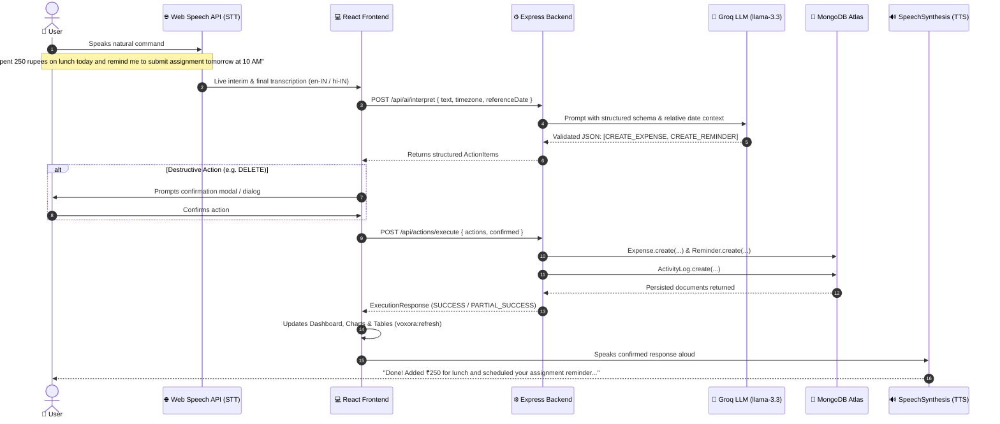

# VOXORA AI
> **"Your Voice. Your Personal AI Action Assistant."**  
> *Product Positioning: Speak. Understand. Act.*

[](https://www.typescriptlang.org/)
[](https://reactjs.org/)
[](https://vitejs.dev/)
[](https://expressjs.com/)
[](https://www.mongodb.com/atlas)
[](https://groq.com/)
[](https://tailwindcss.com/)

---

## 🌟 Executive Overview

**VOXORA AI** is an industry-grade, voice-first intelligent SaaS productivity and expense management assistant built for the **6-hour SOLO Voice AI Hackathon**.

Instead of manually navigating through multiple screens and complex forms, users speak naturally in English or Hindi. VOXORA AI captures the voice, extracts structured multi-intent operations using **Groq LLM (`llama-3.3-70b-versatile`)**, validates the intent payloads with **Zod**, executes genuine database operations in **MongoDB Atlas**, persists audit records in **ActivityLog**, updates the live interactive UI, and speaks back a natural confirmation via **Browser SpeechSynthesis**.

---

## 🔄 The Non-Negotiable Voice Pipeline



---

## 🏗️ Architecture & Technology Stack

### Frontend (Client)
- **Framework:** React 18 with TypeScript & Vite 6
- **Routing:** React Router v7
- **Styling:** Tailwind CSS (Dark theme: deep navy `#0B0F19`, slate card surfaces, indigo `#6366F1` and violet `#8B5CF6` accents)
- **Visuals:** Lucide React icons, Recharts (Donut & Monthly Trend Bar charts), Audio Waveform Visualizer
- **Voice Stack:**
  - Speech-to-Text: Browser `webkitSpeechRecognition` / `SpeechRecognition` (en-IN & hi-IN)
  - Text-to-Speech: Browser `window.speechSynthesis` (with natural voice matching & speed control)
  - Fallback: Manual natural-language text input form

### Backend (Server)
- **Runtime:** Node.js v23 / Express.js with TypeScript
- **Database ODM:** Mongoose 8 connecting to MongoDB Atlas (`MONGODB_URI`)
- **AI Intelligence:** Official Groq SDK (`groq-sdk`) calling `llama-3.3-70b-versatile`
- **Validation:** Zod schemas for all models and action dispatcher payloads
- **Date Handling:** `date-fns` for accurate relative date computations

---

## 🗄️ Database Architecture (MongoDB Atlas)

All models feature strict schema validation, indexes, and automatic timestamps.

### 1. `Expense`
- `_id`: ObjectId
- `amount`: Number (required, positive, minimum 0.01)
- `currency`: String (default `"INR"`)
- `category`: String enum (`Food`, `Travel`, `Shopping`, `Education`, `Entertainment`, `Health`, `Bills`, `Other`)
- `description`: String (required, max 200 characters)
- `date`: Date (indexed descending)
- `createdAt`, `updatedAt`: Timestamps

### 2. `Task`
- `_id`: ObjectId
- `title`: String (required, trimmed, max 200 characters)
- `description`: String (max 1000 characters)
- `priority`: String enum (`low`, `medium`, `high`, default `medium`)
- `status`: String enum (`pending`, `in_progress`, `completed`, default `pending`, indexed)
- `dueDate`: Date (nullable, indexed)
- `createdAt`, `updatedAt`: Timestamps

### 3. `Reminder`
- `_id`: ObjectId
- `title`: String (required, trimmed, max 200 characters)
- `description`: String (max 1000 characters)
- `dueAt`: Date (required, indexed)
- `status`: String enum (`scheduled`, `completed`, `delivered`, default `scheduled`, indexed)
- `notificationSent`: Boolean (default `false`)
- `createdAt`, `updatedAt`: Timestamps

### 4. `ActivityLog`
- `_id`: ObjectId
- `actionType`: String (e.g. `CREATE_EXPENSE`, `COMPLETE_TASK`, `DELETE_EXPENSE`)
- `description`: String
- `entityType`: String enum (`expense`, `task`, `reminder`, `system`, `query`)
- `entityId`: String (optional reference)
- `status`: String enum (`success`, `failed`, `partial`, `pending_confirmation`)
- `metadata`: Mixed JSON object
- `createdAt`: Date (indexed descending)

---

## 🔌 API Reference

### Health & Connectivity
- `GET /api/health` — Returns server uptime, version, MongoDB connection status, and Groq configuration.
- `GET /api/health/db` — Specific database connection verification endpoint (returns 503 if disconnected).

### Dashboard
- `GET /api/dashboard` — Aggregates all-time spending, current month spending, pending/completed tasks, upcoming reminders, category breakdown, monthly trend, recent transactions, and recent activity.

### AI Engine & Action Dispatcher
- `POST /api/ai/interpret` — Sends user text, timezone, and reference date to Groq LLM; returns structured `actions[]` and natural `response`.
- `POST /api/actions/execute` — Allowlisted action dispatcher; runs validated database operations in MongoDB Atlas and returns `ExecutionResponse`.

### Resource CRUD Endpoints
- **Expenses:**
  - `GET /api/expenses` (supports `search`, `category`, `startDate`, `endDate`, `sortBy`, `sortOrder`, `page`, `limit`)
  - `POST /api/expenses`
  - `GET /api/expenses/:id`
  - `PUT /api/expenses/:id`
  - `DELETE /api/expenses/:id`
- **Tasks:**
  - `GET /api/tasks` (supports `status`, `priority`, `search`)
  - `POST /api/tasks`
  - `GET /api/tasks/:id`
  - `PUT /api/tasks/:id`
  - `DELETE /api/tasks/:id`
- **Reminders:**
  - `GET /api/reminders` (supports `status`)
  - `POST /api/reminders`
  - `PUT /api/reminders/:id`
  - `DELETE /api/reminders/:id`
- **Activity Log:**
  - `GET /api/activity` (supports `entityType`, `page`, `limit`)
- **Settings:**
  - `GET /api/settings` — Returns current status with masked keys.
  - `POST /api/settings` — Live update `MONGODB_URI` and `GROQ_API_KEY` directly from browser without server restart.

---

## 🚀 Quickstart & Installation

### Prerequisites
- Node.js v18+ (tested on Node v23)
- npm v9+

### 1. Clone & Install Dependencies
```bash
# In the project root directory:
npm run install:all
```
This runs `npm install` in the root, `server/`, and `client/`.

### 2. Configure Environment Variables
Copy `.env.example` in `server/`:
```bash
cp server/.env.example server/.env
```
Edit `server/.env`:
```env
PORT=5000
NODE_ENV=development
CLIENT_URL=http://localhost:5173

# Replace with your MongoDB Atlas cluster URI:
MONGODB_URI=mongodb+srv://<username>:<password>@cluster0.mongodb.net/voxora?retryWrites=true&w=majority

# Replace with your Groq API Key:
GROQ_API_KEY=gsk_your_groq_api_key_here
GROQ_MODEL=llama-3.3-70b-versatile
```
*(Alternatively, you can leave them blank and paste them directly in the application's **Settings Page** UI upon launching!)*

### 3. Run Development Servers
From the root directory, start both frontend and backend concurrently:
```bash
npm run dev
```
- **Backend API:** `http://localhost:5000/api`
- **Frontend App:** `http://localhost:5173`

---

## 🎯 6 Required Hackathon Test Commands

VOXORA AI has a dedicated **1-Click Test Preset** section on the Voice Assistant page to instantly run all 6 test commands:

| Test | Natural Command | Identified Intent | Expected Database Operation | Spoken Response |
|------|-----------------|-------------------|-----------------------------|-----------------|
| **Test 1** | *"I spent 250 rupees on lunch today."* | `CREATE_EXPENSE` | Inserts ₹250 Food expense into MongoDB Atlas. | *"Added ₹250 for Lunch."* |
| **Test 2** | *"Remind me to submit my assignment tomorrow at 10 AM."* | `CREATE_REMINDER` | Calculates tomorrow 10:00 AM ISO datetime; inserts scheduled reminder. | *"Reminder set: 'Submit my assignment' for [Date], 10:00 AM."* |
| **Test 3** | *"I spent 500 rupees on travel and create a task to prepare my resume by Friday."* | `CREATE_EXPENSE` + `CREATE_TASK` | Creates 1 Travel expense (₹500) AND 1 Task ("Prepare my resume") due Friday. | *"Added ₹500 for travel. Created task 'Prepare my resume'."* |
| **Test 4** | *"How much did I spend this month?"* | `QUERY_EXPENSES` | Runs real MongoDB aggregation `$match` for current month and `$sum` amount. | *"You have spent ₹750 across 2 expenses this month."* |
| **Test 5** | *"Mark my resume task as completed."* | `COMPLETE_TASK` | Searches active task matching "resume" and sets `status = 'completed'`. | *"Marked your task 'Prepare my resume' as completed."* |
| **Test 6** | *"Delete my lunch expense."* | `DELETE_EXPENSE` | Locates target expense; presents confirmation modal; deletes only after approval. | *"Deleted your Lunch expense of ₹250."* |

---

## 🎙️ 3-Minute Live Judging Presentation Script

### Minute 1: The Problem & The Vision (0:00 - 1:00)
> *"Hello judges! Productivity and expense management apps usually suffer from high friction: dropdowns, date pickers, manual category clicks, and multi-screen navigation.*  
> *Meet **VOXORA AI**: 'Your Voice. Your Personal AI Action Assistant.' Our tagline is simple: **Speak. Understand. Act.***  
> *Unlike traditional voice chatbots that only chat, VOXORA is an **action assistant**. When you speak, it doesn't just reply — it parses multiple independent intents through **Groq LLM**, saves real documents into **MongoDB Atlas**, schedules native alerts, updates the live dashboard, and speaks the confirmation aloud."*

### Minute 2: Live End-to-End Pipeline Demo (1:00 - 2:15)
*(Demonstrate directly on `http://localhost:5173/voice`)*
1. **Multi-Action Command (Test 3):**
   - Click the animated microphone button and speak:  
     *"I spent 500 rupees on travel and create a task to prepare my resume by Friday."*
   - Show: Live waveform pulses -> Web Speech transcription appears in real-time -> Groq parses 2 distinct actions -> Both save to MongoDB Atlas -> System speaks confirmation.
   - Click **Dashboard**: show the ₹500 expense recorded, the category pie chart updated, and the task added to pending tasks!
2. **Aggregated Database Query (Test 4):**
   - Click mic: *"How much did I spend this month?"*
   - Show: Groq does **not** hallucinate financial figures. The backend runs a real MongoDB `$sum` aggregation and speaks the actual sum.
3. **Safety & Destructive Confirmation (Test 6):**
   - Click mic: *"Delete my lunch expense."*
   - Show: AI detects a destructive action, flags `requiresConfirmation: true`. A confirmation modal pops up. Once the user clicks "Yes, Delete Record", it removes the document and logs the action to Activity History!

### Minute 3: Architecture, Polish & Hackathon Impact (2:15 - 3:00)
> *"Under the hood:*
> - *Frontend: React 18, TypeScript, Tailwind CSS, Recharts for financial analytics, and responsive design.*
> - *Backend: Express REST APIs, Mongoose ODM with strict schemas, indexes, and full CRUD.*
> - *AI Engine: Groq `llama-3.3-70b-versatile` with Zod schema validation.*
> - *Reliability: Connection status verification on MongoDB, permission handling for microphone and notifications, CSV export, and dual English/Hindi language support.*  
> *VOXORA AI transforms passive LLMs into active, dependable assistants that get real work done. Thank you!"*

---

## ⚖️ Honest Feature Checklist & Hackathon Limitations

### Implemented & Fully Functional
- [x] Complete Voice Pipeline: Voice Input → STT → Groq AI → MongoDB Atlas → TTS output.
- [x] Full CRUD for Expenses, Tasks, and Reminders with MongoDB Atlas persistence.
- [x] Multi-intent extraction from single natural language utterances.
- [x] Real MongoDB aggregation for financial queries (no hallucinated figures).
- [x] Interactive Dashboard with real-time KPI metrics, category donut chart, and monthly bar chart.
- [x] Destructive operation safety (confirmation dialogs for deletions).
- [x] Activity history audit trail for all operations.
- [x] CSV export of financial expenses.
- [x] Browser Web Speech API with interim transcriptions and error recovery.
- [x] Browser SpeechSynthesis with customizable voice speed, pitch, and language support (`en-IN` & `hi-IN`).
- [x] Browser Web Notifications for scheduled reminders.
- [x] In-browser Cloud Settings manager to test and update `MONGODB_URI` and `GROQ_API_KEY`.
- [x] 1-Click test presets for all 6 required demo commands.

### Hackathon MVP Scope & Limitations
- **Single-User Workspace:** For this 6-hour hackathon MVP, the database is architected as a single-user workspace. Authentication (JWT/OAuth) can be layered on top by adding a `userId` field to the Mongoose schemas.
- **Browser-based Reminders:** Scheduled alerts use the browser's Web Notifications API, requiring the tab to be open or running in the background. A production background push service (e.g. Web Push / Firebase Cloud Messaging) can be added for offline delivery.
- **Microphone Browser Support:** Speech recognition uses the Web Speech API (`webkitSpeechRecognition`), supported in Chrome, Edge, and Chromium browsers; manual text fallback is provided for other environments.

---

## 📄 License
MIT License. Built for the Solo Voice AI Hackathon.

